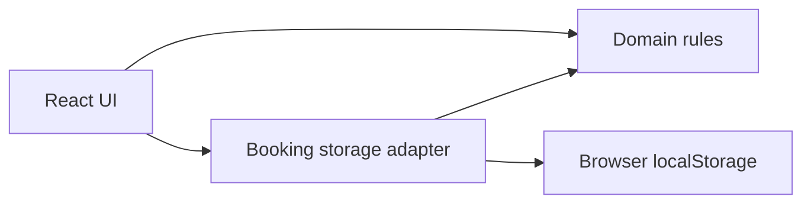

# Architecture Spine — Meeting-room booking prototype

## Design Paradigm

Layered client application: React components present and collect input; plain TypeScript modules under `src/domain/` decide booking validity and availability; one browser-storage adapter owns persistence.



## Invariants & Rules

### AD-1 — Domain boundary [ADOPTED]

- **Binds:** Availability, booking creation, cancellation, and any future booking UI.
- **Prevents:** Separate screens implementing conflicting booking rules.
- **Rule:** All booking decisions live in React-free modules under `src/domain/`. React components invoke those rules; domain modules import neither React nor browser APIs. Unit tests cover each rule and its edge cases.

### AD-2 — Single booking mutation path

- **Binds:** Every operation that changes bookings.
- **Prevents:** One flow bypassing collision validation or writing a different storage shape.
- **Rule:** One storage adapter owns the canonical booking collection in `localStorage`. Every mutation reads the current collection, applies domain validation, and writes the resulting collection. UI code never writes booking data directly.

### AD-3 — Time and overlap semantics

- **Binds:** Availability display, slot selection, and collision checks.
- **Prevents:** Today/week views and booking forms disagreeing at boundaries.
- **Rule:** Model bookings as local calendar dates and half-open time intervals `[start, end)`. Start and end use 30-minute boundaries; valid occupied time is within 08:00–20:00. Two bookings conflict only when they share a room and their intervals overlap on the same date.

### AD-4 — Device-local authority [ADOPTED]

- **Binds:** Booking data, availability claims, and deployment.
- **Prevents:** The UI implying that separate devices share a booking ledger.
- **Rule:** The browser profile's `localStorage` is authoritative for this single-device prototype, operated from one active tab. Availability and collision prevention apply to that tab's saved bookings. The app has no server, API, account service, or synchronization path.

## Consistency Conventions

| Concern | Convention |
| --- | --- |
| Room identity | Use stable room IDs; names and capacities are display data. |
| Booking identity | Assign a stable booking ID at creation; do not use a person's name as an ID. |
| Storage format | One versioned booking collection; parsing and invalid-data handling stay in the storage adapter. |
| Error handling | Domain validation returns an explicit failure for invalid slots or conflicts; UI renders it without changing stored bookings. |

## Stack

| Name | Version |
| --- | --- |
| React | 19.3.1 |
| TypeScript | 7.0.2 |
| Vite | 8.3.4 |
| Vitest | 5.0.5 |

Versions reflect the existing `package.json`; the repository owns the exact versions after this seed.

## Structural Seed

```text
src/
  domain/       booking and availability rules
  App.tsx       UI composition
```

The storage adapter can sit in `src/` outside `domain/` so browser APIs do not enter the domain layer. Deploy Vite's static build to GitHub Pages. There is no application service or external data provider to operate; browser storage is reset by clearing site data.

## Deferred

- **[ASSUMPTION] Fixed room inventory:** Keep the three rooms in source data and persist bookings only. Revisit if room management enters scope.
- **Maximum booking duration:** The idea says members should not occupy a room all day, but gives no limit. Define the limit before implementing booking validation.
- **Cancellation and ownership:** Name-only entry provides no identity assurance. Decide who may cancel or edit a booking before building those flows.
- **Recurring bookings and room displays:** Future ideas; decide their contracts when scoped.
- **Shared availability across devices:** Requires a different data authority and a change to the client-only constraint; revisit only if prototype scope changes.
- **Concurrent tabs:** `localStorage` does not provide an atomic read-check-write transaction. Revisit if simultaneous use in multiple tabs is required.
